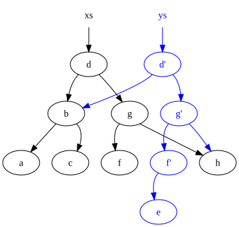

# Design Doc (WIP)

## Introduction

ArchiaDB is a hierarchical, embedded, transactional database. This document provides a broad overview of its implementation and design decisions.

## Primary Motivations

- Async rust and io_uring - These technologies make it possible to significantly reduce kernel space context switching. I wanted to explore this design space for my own educational purposes, and see if it would have any notable impact on overall performance.
- Strictly serializable by default - The pervasiveness of snapshot serializable isolation or weaker models by default is baffling to me. Even for experienced engineers, it is far too easy to introduce subtle bugs in complex read-write transactions.
- Hierarchical data model - This paradigm struck me as intriguing and fairly underutilized. Combined with strict serializable isolation hierarchical modelling makes implementing multi-index data and complex transactions in application code intuitive, safe, and parallelizable. It also lends itself quite naturally to the COW data structures.
- Non-declarative - While query languages provide a convenient and powerful abstraction for rapid iteration and business applications development, they are also a leaky abstraction that carries overhead. Expressing operations procedurally with a native programming language is fast, clear, and more ergonomic.

## Hierarchical Modeling

Hierarchical modelling is one paradigm among others like relational, document, or graph; providing a higher-level structure to a set of records. It may help to think of it as nothing more than a nestable key-value store. The following in-memory representation is effectively equivalent:

```rust
struct DB(Map);
type Map = BTreeMap<Key, Value>;
type Key = Box<[u8]>;
enum Value {
   Data(Box<[u8]>),
   Map(Map)
}
```

## COW B+trees

B+trees are a ubiquitous structure used in storage engines. For those unfamiliar, they are a self-balancing sorted tree map with a high branching factor and values only stored in leaves.  Most underlying storage devices (HDDs, SSDs) are designed to work best with fixed size blocks (commonly 4kb), so B+trees are suitable because their nodes can make efficient use of fixed size blocks.

In order to understand copy on write (COW) B+trees, it is pertinent to briefly explain the in-place versions used by many databases. In such systems, modifying operations are carefully programmed to be idempotent, and a record describing each operation is appended to a write ahead log (WAL) before it is actually executed. For recovery after an unexpected shutdown, operations from the WAL may be safely replayed, which will clean up any partially applied modifications to the B+tree, ultimately ensuring on-disk data integrity. COW maintains integrity by never overwriting data; instead, nodes are copied, modified and written to new locations in the file.

### Path Copying

This technique is widely employed by persistent immutable data structures. For B+trees, in order to modify leaf nodes which contain all the keys and values, node COW is performed recursively until reaching the root. This results in two roots, one pointing to the previous version and one pointing to a new version that contains the applied modification, but is composed of both new and old nodes.



### Double Buffered Root

Path copying cannot regress infinitely. If the goal is to replace the old version, at some point it must terminate with an in-place modification. In-memory data structures can simply update a pointer to the root, but databases do not get that luxury. To solve this, ArchiaDB adopts a clever technique from LMDB.

Each root node comprises two pages (or buffers) and each contains two important fields: a version, which is a monotonically increasing integer, and a checksum, which is stored at the end of the page. The canonical root data is determined by choosing the page with the higher version and a correct checksum. To update the root, data containing an incremented version and calculated checksum is written to the old, non-canonical page. If a crash occurs during this process, a torn (partial) write can be detected by checksum, and the tree can be restored from the prior version.

In order to atomically commit transactions, which may touch multiple B+trees, ArchiaDB finds the least common ancestor (LCA) of all the dirty trees and applies path copying all the way up to the LCA B+tree’s root, where it then performs the double buffer root procedure.

## Transactions

### Background

Transactions in ArchiaDB use conservative two phase locking (2PL). In the API, this translates to declaring the entire read/write set upfront. This design makes it difficult to create transactions that do not know their full read/write set ahead of time; consider, for instance, a bank transfer where the two usernames are known but not the account ids. However, this issue can be mitigated by utilizing non-blocking reads combined with optimistic concurrency control, or by pessimistically locking more of the node tree.

One of the main benefits of conservative 2PL is that it can entirely avoid deadlocks and livelocks. Many traditional DBMS's perform the first phase dynamically; locks are acquired as the transaction makes progress based on what data it attempts to read or write. For those unfamiliar with this problem space, when two concurrent processes compete for mutual exclusion on two resources but in opposite order, it's possible for each one to lock the resource the other one needs, causing both processes to enter a stuck state. Traditional DBMS's get around this using complex deadlock detection systems, which monitor locks, identify deadlocked processes, and force cancellation so that at least one of them can make progress. However, on high throughput systems, complex transactions may end up livelocked. When more data is touched, there is a higher probability of cancellation, creating the possibility that a transaction is stuck retrying and never completes. The solution to deadlocks when using conservative 2PL is to give locks a global ordering, such that each process always acquires/releases them in the same order.

### Top-Down Locking

Top-down locks refer to the locks acquired at the very beginning of a transaction and released at the very end. The database utilizes a unique scheme in order to best take advantage of its hierarchical structure. Each node in the B+tree hierarchy has effectively a read/write lock following the golden rule of single writer XOR multiple readers. Locks for the node tree are acquired in BFS order and lexicographically across siblings. Each one uses a fair, FIFO wait queue, to make sure that transactions, regardless of complexity, are always eventually processed.

Users may declare one of three transaction operations on a given node: read, write, and read recursive. The first two are self explanatory, the last one effectively acquires a read lock on a given node and all of its descendants. There is an additional hidden lock type, not directly exposed to the user called read-child-write. This lock is acquired on each ancestor on the path to a write lock and ensures that a read recursive lock can never acquire a sub-tree with an ongoing write and vice versa.

### Bottom-up Locking

These refer to locks that are acquired/released during the commit procedure, which can be triggered by the user any number of times during a transaction. The main issue addressed by this algorithm is that the least common ancestor (LCA) of the dirty nodes may not be in the write lock set of a given transaction, so doing an atomic double-buffered root page write is not trivial to do safely. Consider the case of three nodes: A, B, C, where A is the parent of B and C, and we have a transaction which has acquired top-down write locks on B and C. To properly do path-copying and double-buffered atomic commit, we must modify node A. Concurrent transactions that also have node A as their LCA could conflict, so the database acquires "bottom-up" write locks on the dirty node's ancestors up to the LCA. These are locked in reverse BFS order, and the commit algorithm roughly follows this procedure:

1. write dirty transaction pages
2. acquire bottom-up locks
3. write pages on path to LCA
4. fsync
5. double-buffered atomic LCA write
6. fsync
7. release bottom-up locks

### Read-Only

While typical transactions can be either read or write, they are always strictly serializable and may block on other ongoing transactions. ArchiaDB also offers non-blocking read-only transactions at the lower snapshot serializable isolation level. From an implementation perspective, read-only transactions are trivial to implement due to the database's COW B+tree structure. The main concern is that read-only processes could read “dirty” pages referenced by the non-canonical B+tree root buffer, which have been written over; however, the database contains in-memory bookkeeping mechanisms to ensure that pages are not reused until there are no longer any transactions that could reference them.

## IO Layer

ArchiaDB's transaction processing and persistent data structures are built atop a minimal IO layer API, referred to as BIO (for block input/output). The following is a simplified trait definition:


```rust
trait BlockIo {
    type Buf: AsMut<[u8]> + AsRef<[u8]>;

    fn page_size(&self) -> InPgIdx;
    fn buf(&self) -> Self::Buf;
    async fn read(&self, pg_idx: PgIdx) -> Result<Self::Buf>;
    async fn write(&self, pg_idx: PgIdx, buf: Self::Buf) -> Result<()>;
    // extend the size of a file
    async fn alloc(&self, size: PgIdx) -> Result<()>;
    // ensure all previous writes are durable
    async fn sync(&self) -> Result<()>;
}
```

As may be already obvious, all IO is done via fixed sized blocks which are referred to as pages. ArchiaDB attempts to choose a page size equal to the filesystem block size, but in some cases may choose a multiple of it; regardless, page size does not change for a database file after creation.

The default implementation on Linux uses io_uring. In order to stay agnostic of async runtime, BIO runs its own background thread for request processing. Each BIO function creates a custom future object, then submits the future's waker and operation specific data to an unbounded lock-free queue. The background thread polls this queue, automatically sleeping when there is no work to do, and translates each operation into io_uring requests that are batched, submitted, and reaped, finally the waker is called to notify the async runtime when a given operation is finished.

One notable optimization is that sync function calls, which are translated to a fsync requests, are temporally batched such that there is only ever one inflight fsync at any given time. This means that code throughout the database and across parallel tasks execution can liberally call sync without its latency ever being much higher than a stand alone fsync call.

Another optimization is use of DMA and pools for zero-copy buffers. BIO registers a fixed number of DMA buffers with io_uring on initialization. A portion of these buffers, equal to the size of the completion queue, are reserved for heap buffer copying, and the rest are used as a zero-copy pool. Page buffers are needed whenever client code requests one for use in a write request or when the background thread needs one for returning read results. First, BIO attempts to hand out what is effectively a pointer to a buffer in the zero-copy pool. However, because client code can hold onto these buffers for indeterminate amounts of time, BIO will fallback to a regular heap allocated buffer when none are available. These heap buffers then have their contents copied into/out of the reserved buffer range. This system ensures that the kernel is always operating on a fixed set of registered buffers, uses zero-copy when possible, and also never blocks CPU-bound work.

## Page Allocation

### Local Allocation

Each B+tree in ArchiaDB maintains its own local allocation system that consists of an arena and free list.

The arena is just a simple bump allocator. Each arena points to a contiguous chunk of pages and maintains a pointer separating the allocated section from the free section. The free list is a linked list of pages where each page is itself packed with free page indexes. The most interesting thing about this system is that the linked list is also COW and a pointer to the head is stored in the double buffered B+tree root header. Modifications always are performed starting from the head, so write transaction overhead is proportional to the amount of allocation work done, not the length of the list.

### Global Allocation

When B+tree roots are first created or when one runs out of pages in their local allocator, a new arena is allocated for it by the global allocator which bumps the size of the file. The procedure works like so:

1. acquire global alloc lock
2. falloc, extend file to create new arena
3. write new file length and global alloc target B+tree to database meta page
4. fsync
5. write arena information to B+tree root page
6. fsync
7. wipe global alloc target B+tree from meta page
8. fsync
9. release lock

These steps and multiple fsyncs are important for crash recovery, since a mutation to both the file size contained in the meta page and the arena data in the B+tree root page cannot be committed atomically. A crash that occurs after extending the file but before the new arena has been written to the B+tree is at risk of leaking a chunk of the file. On startup, this case can be trivially detected by checking if there is a target B+tree in the meta page and the global allocation process finished.

## File Format

### Storage Assumptions

There is really only one main assumption that ArchiaDB makes about the underlying storage device: after an fsync operation, all previously written pages are persisted. Unlike other databases/formats, there is no assumption of properties like atomic single byte write or powersafe overwrite, which makes ArchiaDB a very resilient format.

Each page also reserves 64 bits at the end for a checksum. Whenever a page is read from disk this checksum is validated and an error returned if it is not wrong. Currently, ArchiaDB uses rapidhash V3, with preliminary tests showing that updating and validating page checksums results in about 15% lower throughput than non-checksummed page IO.

### Integer Types and Page Specs

In order to preserve space without sacrificing too much on future proofing, some integers are encoded in unusual sizes. Notably, page indexes use 40 bit integers and in-page indexes use 24 bit integers. Additionally, all integers are encoded in little endian regardless of platform.

These specs are not valid rust or code accurate. They are flattened pseudo-rust specifications of each page type's disk layout.

### Metadata Pages

The first two pages of each database file contain metadata and are double buffered just like B+tree roots. Since ArchiaDB’s minimum page size is 4kb there is a significant amount of unused space available for future fields.

```rust
#[repr(C, packed)]
struct MetaPage {
    magic: u128,
    fmt_ver: u16,
    pg_size: u24,
    root1: u40,
    root2: u40,
    version: u64,
    open: u8,
    len: u40,
    galloc_fidx: u40,
    galloc_bidx: u40,
    galloc_len: u40,
}
```

### B+tree Pages

#### Root

```rust
#[repr(C, packed)]
struct BTreeNodeRoot {
    kind: u8,
    len: u24,
    version: u64,
    free: u40,
    arena_start: u40,
    arena_len: u24,
    arena_next: u24,
    slots: [u24; max(0,len-1)], // byte offsets into child_pages_and_keys

    // remaining data grows backwards from end
    child_pages_and_keys: [(u40, [u8])],
    first_child_page: u40
}
```

#### Inner

```rust
#[repr(C, packed)]
struct BTreeNodeInner {
    kind: u8,
    len: u24,
    slots: [u24; max(0,len-1)], // byte offsets into child_pages_and_keys

    // remaining data grows backwards from end
    child_pages_and_keys: [(u40, [u8])],
    first_child_page: u40
}
```

#### Leaf

```rust
#[repr(C, packed)]
struct BTreeNodeLeaf {
    kind: u8,
    len: u24,
    slots: [u24; len], // byte offsets into values_and_keys

    // remaining data grows backwards from end
    values_and_keys: [(Value, [u8])]
}

#[repr(C, packed)]
struct enum Value {
    BTree {
        pg_idx_1: u40,
        pg_idx_2: u40
    },
    Small {
        len: u24,
        data: [u8; len]
    },
    Large {
        pg_idx: u40, // linked list head
        len: u40 // in bytes
    }
}
```
